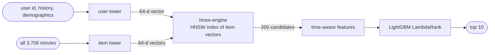

# two-stage-recsys

**A two-stage movie recommender built the way large production systems are.** A PyTorch
**two-tower model** embeds users and movies in one vector space; **hnsw-engine** (my own HNSW
vector search library, built from scratch in the companion project) retrieves 200 candidates per
user from the full catalog; a **LightGBM LambdaRank** model reorders them using time-aware
features; a **FastAPI service** serves recommendations with a per-stage latency breakdown.
Evaluated on MovieLens-1M with full-catalog ranking (no sampled negatives), a leakage-tested
temporal split, 95% bootstrap confidence intervals and three-seed ablations. The full system
doubles a carefully tuned matrix-factorisation baseline (NDCG@10 0.0906 versus 0.0445), and the
result holds on MovieLens-10M, ten times larger, with every setting carried over (0.1047 versus
0.0524).

## Results (MovieLens-1M test set, 6,035 users, 3,706 movies)

Point estimate [95% bootstrap interval]. Paired comparisons and retrieval costs:
[`docs/RESULTS.md`](docs/RESULTS.md); ablations and subgroups: [`docs/ANALYSIS.md`](docs/ANALYSIS.md).

<!-- table:results_main -->
| Method | Recall@10 | Recall@50 | NDCG@10 | MRR | Coverage@10 (point) |
|---|---:|---:|---:|---:|---:|
| Popularity | 0.0393 [0.0345, 0.0441] | 0.1287 [0.1208, 0.1375] | 0.0193 [0.0167, 0.0222] | 0.0205 [0.0184, 0.0229] | 0.0310 |
| Item-item co-occurrence | 0.0547 [0.0489, 0.0603] | 0.1814 [0.1723, 0.1914] | 0.0276 [0.0244, 0.0311] | 0.0283 [0.0256, 0.0311] | 0.0977 |
| Implicit ALS | 0.0886 [0.0817, 0.0961] | 0.2848 [0.2741, 0.2956] | 0.0445 [0.0409, 0.0489] | 0.0439 [0.0409, 0.0475] | 0.2178 |
| Two-tower, exact retrieval | 0.1210 [0.1128, 0.1294] | 0.3319 [0.3200, 0.3433] | 0.0615 [0.0570, 0.0664] | 0.0568 [0.0528, 0.0609] | 0.5013 |
| Two-tower via hnsw-engine (200 candidates) | 0.1215 [0.1133, 0.1301] | 0.3317 [0.3196, 0.3430] | 0.0619 [0.0573, 0.0668] | 0.0571 [0.0532, 0.0612] | 0.5024 |
| Two-tower + LightGBM ranker | 0.1692 [0.1597, 0.1781] | 0.3992 [0.3872, 0.4118] | 0.0906 [0.0848, 0.0959] | 0.0806 [0.0757, 0.0852] | 0.5774 |
<!-- /table:results_main -->

**Scale check: MovieLens-10M** (69,613 test users, all 10,677 movies; `make ml10m`, settings
from ML-1M, no demographics in this release). NDCG@10 [95% CI], full table in
[`docs/RESULTS.md`](docs/RESULTS.md):

| Method | MovieLens-1M | MovieLens-10M |
|---|---:|---:|
| Tuned implicit ALS | 0.0445 [0.0409, 0.0489] | 0.0524 [0.0511, 0.0536] |
| Two-tower, exact retrieval | 0.0615 [0.0570, 0.0664] | 0.0808 [0.0792, 0.0824] |
| Two-tower via hnsw-engine | 0.0619 [0.0573, 0.0668] | 0.0805 [0.0789, 0.0820] |
| Two-tower + LightGBM ranker | 0.0906 [0.0848, 0.0959] | 0.1047 [0.1030, 0.1066] |

## How it works



1. **Retrieval.** The two towers are trained with an in-batch softmax and log-Q correction
   (Yi et al., 2019), so a user's vector lands near the movies they will watch. A user's history
   input only ever contains *earlier* likes, so training cannot peek at the future.
2. **Serving the candidates.** Item vectors go into hnsw-engine's compiled engine; one approximate
   nearest-neighbour query (0.094 ms) returns 200 fresh candidates, 98.4% of the exact top-200.
3. **Ranking.** LightGBM LambdaRank, trained on validation targets only, scores the candidates with
   the two-tower score and rank, popularity *before* the request time, release year, genre
   affinity, user activity, demographics and the similarity of each candidate to the user's most
   recent movies (the feature that made the ranker work, see below).

## What makes it trustworthy

* **No leakage, by test**: no target appears in its user's training data; histories contain only
  earlier events; popularity features are checked against a brute-force count of events strictly
  before each user's target time.
* **Honest evaluation**: every method ranks the full catalog; hyperparameters (including a
  three-pass ALS grid) are chosen on validation data; test targets are used once per final model.
* **Negative results reported**: the first ranker scored *below* plain retrieval; it was diagnosed
  on validation data only and fixed with recency features ([`docs/RESULTS.md`](docs/RESULTS.md)).
* **Reproducible**: versioned YAML configs, fixed seeds, bit-identical reruns, every run saved with
  its config and environment; `make reproduce` regenerates every number.

## Quick start

```bash
uv pip install -e "hnsw-engine" -e "two-stage-recsys[bench,serve,dev]"
cd two-stage-recsys
make check            # lint, strict type check, tests
make reproduce        # data, baselines, two-tower, retrieval, ranker, results (about 6 minutes)
make serve            # http://127.0.0.1:8000/recommend/42
make ml10m            # Tier 3 scale check on MovieLens-10M (65.6 MB download, about an hour)
```

In Docker (built and tested; answers identical to the native service, see the
[model card](docs/MODEL_CARD.md)):

```bash
docker build -f two-stage-recsys/Dockerfile -t two-stage-recsys:0.1.0 .   # from the workspace root
docker run --rm -p 8000:8000 \
  -v "$PWD/two-stage-recsys/data:/app/two-stage-recsys/data:ro" \
  -v "$PWD/two-stage-recsys/results:/app/two-stage-recsys/results:ro" two-stage-recsys:0.1.0
```

`make docker` builds, starts and checks the container (`experiments/docker_smoke.py`);
`make load-test-docker` measures it next to the native service.

## Limitations

* Per-user leave-last-out is the standard protocol but not a global time split: models see other
  users' later interactions; validation targets serve both two-tower early stopping and ranker
  training ([`docs/DESIGN.md`](docs/DESIGN.md)).
* MovieLens is small (3,706 movies): exact search is faster than the ANN index here (0.046 ms), so
  the index demonstrates the serving path rather than a necessity.
* One dataset family (MovieLens 1M, and 10M as a scale check), CPU only, offline evaluation;
  demographic features are used on ML-1M as the brief asks and are discussed in the
  [model card](docs/MODEL_CARD.md).

## Documents

[`DESIGN.md`](docs/DESIGN.md) · [`DECISIONS.md`](docs/DECISIONS.md) ·
[`DATASETS.md`](docs/DATASETS.md) · [`RESULTS.md`](docs/RESULTS.md) ·
[`ANALYSIS.md`](docs/ANALYSIS.md) · [`MODEL_CARD.md`](docs/MODEL_CARD.md) ·
[`REPORT.md`](docs/REPORT.md)
